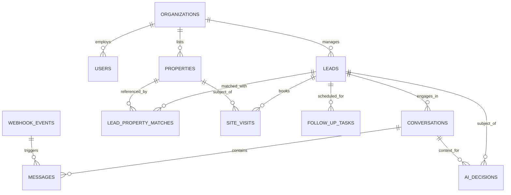

# Relational Database Schema & Data Dictionary

**Database Target:** PostgreSQL 15+ (Supabase)  
**ORM:** SQLAlchemy 2.0 (Async + Sync)  
**Migration Tool:** Alembic  

---

## 1. Entity-Relationship Overview

---

## 2. Table Specifications

### 2.1 `organizations`
Supports multi-tenant expansion for agencies and builders.
- `id` (UUID, Primary Key, default `gen_random_uuid()`)
- `name` (VARCHAR(255), Not Null)
- `slug` (VARCHAR(100), Unique, Not Null)
- `created_at` (TIMESTAMPTZ, default `NOW()`)
- `updated_at` (TIMESTAMPTZ, default `NOW()`)

### 2.2 `users`
Internal sales agents, managers, and administrators.
- `id` (UUID, Primary Key)
- `organization_id` (UUID, Foreign Key `organizations.id`, Nullable)
- `email` (VARCHAR(255), Unique, Not Null)
- `hashed_password` (VARCHAR(255), Not Null)
- `full_name` (VARCHAR(255), Not Null)
- `role` (VARCHAR(50), default `'agent'`) -- `admin`, `manager`, `agent`
- `is_active` (BOOLEAN, default `TRUE`)
- `created_at` (TIMESTAMPTZ, default `NOW()`)

### 2.3 `properties`
Authoritative real estate inventory catalog.
- `id` (UUID, Primary Key)
- `organization_id` (UUID, Foreign Key `organizations.id`, Nullable)
- `name` (VARCHAR(255), Not Null)
- `property_type` (VARCHAR(50), Not Null) -- `APARTMENT`, `VILLA`, `PLOT`, `PENTHOUSE`, `COMMERCIAL`
- `location` (VARCHAR(255), Not Null)
- `address` (TEXT, Nullable)
- `price_min` (BIGINT, Not Null)
- `price_max` (BIGINT, Not Null)
- `bedrooms` (INTEGER, Nullable)
- `bathrooms` (INTEGER, Nullable)
- `area_sqft` (INTEGER, Nullable)
- `amenities` (JSONB, default `'[]'`)
- `status` (VARCHAR(50), default `'AVAILABLE'`) -- `AVAILABLE`, `RESERVED`, `SOLD`
- `images` (JSONB, default `'[]'`) -- Array of image URLs / storage paths
- `metadata` (JSONB, default `'{}'`)
- `created_at` (TIMESTAMPTZ, default `NOW()`)
- `updated_at` (TIMESTAMPTZ, default `NOW()`)

### 2.4 `leads`
Prospects inquiring about real estate.
- `id` (UUID, Primary Key)
- `organization_id` (UUID, Foreign Key `organizations.id`, Nullable)
- `phone` (VARCHAR(50), Unique, Not Null) -- Normalized E.164 format
- `name` (VARCHAR(255), Nullable)
- `preferred_location` (VARCHAR(255), Nullable)
- `property_type` (VARCHAR(50), Nullable)
- `bedroom_preference` (INTEGER, Nullable)
- `budget_min` (BIGINT, Nullable)
- `budget_max` (BIGINT, Nullable)
- `purchase_timeline` (VARCHAR(100), Nullable) -- e.g., `< 1 month`, `1-3 months`
- `financing_status` (VARCHAR(100), Nullable) -- e.g., `Pre-approved`, `Self-funded`
- `lead_score` (INTEGER, default 0)
- `lead_category` (VARCHAR(20), default `'COLD'`) -- `HOT`, `WARM`, `COLD`
- `qualification_reasons` (JSONB, default `'[]'`)
- `assigned_agent_id` (UUID, Foreign Key `users.id`, Nullable)
- `consent_status` (VARCHAR(50), default `'OPTED_IN'`) -- `OPTED_IN`, `OPTED_OUT`
- `created_at` (TIMESTAMPTZ, default `NOW()`)
- `updated_at` (TIMESTAMPTZ, default `NOW()`)

### 2.5 `conversations`
Metadata and active state for lead chat sessions.
- `id` (UUID, Primary Key)
- `lead_id` (UUID, Foreign Key `leads.id`, Not Null)
- `channel` (VARCHAR(50), default `'whatsapp'`)
- `state` (VARCHAR(50), default `'NEW_ENQUIRY'`) -- `ConversationState`
- `is_human_takeover` (BOOLEAN, default `FALSE`)
- `last_message_at` (TIMESTAMPTZ, default `NOW()`)
- `created_at` (TIMESTAMPTZ, default `NOW()`)

### 2.6 `messages`
Individual chat messages sent or received.
- `id` (UUID, Primary Key)
- `conversation_id` (UUID, Foreign Key `conversations.id`, Not Null)
- `external_message_id` (VARCHAR(255), Unique, Nullable) -- Meta WhatsApp message ID
- `direction` (VARCHAR(20), Not Null) -- `INBOUND`, `OUTBOUND`
- `message_type` (VARCHAR(50), default `'text'`)
- `content` (TEXT, Not Null)
- `status` (VARCHAR(50), default `'RECEIVED'`) -- `RECEIVED`, `PROCESSED`, `SENT`, `FAILED`
- `metadata` (JSONB, default `'{}'`)
- `created_at` (TIMESTAMPTZ, default `NOW()`)

### 2.7 `lead_property_matches`
Auditable record of properties matched to a lead by the AI engine.
- `id` (UUID, Primary Key)
- `lead_id` (UUID, Foreign Key `leads.id`, Not Null)
- `property_id` (UUID, Foreign Key `properties.id`, Not Null)
- `match_score` (INTEGER, Not Null)
- `explanation` (TEXT, Not Null)
- `recommended_at` (TIMESTAMPTZ, default `NOW()`)

### 2.8 `site_visits`
Scheduled on-site property walkthroughs.
- `id` (UUID, Primary Key)
- `lead_id` (UUID, Foreign Key `leads.id`, Not Null)
- `property_id` (UUID, Foreign Key `properties.id`, Not Null)
- `assigned_agent_id` (UUID, Foreign Key `users.id`, Nullable)
- `scheduled_time` (TIMESTAMPTZ, Not Null)
- `duration_minutes` (INTEGER, default 45)
- `status` (VARCHAR(50), default `'REQUESTED'`) -- `REQUESTED`, `CONFIRMED`, `COMPLETED`, `CANCELLED`
- `google_calendar_event_id` (VARCHAR(255), Nullable)
- `notes` (TEXT, Nullable)
- `created_at` (TIMESTAMPTZ, default `NOW()`)

### 2.9 `follow_up_tasks`
Application-owned background nurturing triggers.
- `id` (UUID, Primary Key)
- `lead_id` (UUID, Foreign Key `leads.id`, Not Null)
- `scheduled_for` (TIMESTAMPTZ, Not Null)
- `attempt_number` (INTEGER, default 1)
- `status` (VARCHAR(50), default `'PENDING'`) -- `PENDING`, `EXECUTED`, `CANCELLED`, `FAILED`
- `task_type` (VARCHAR(100), default `'nurturing_message'`)
- `payload` (JSONB, default `'{}'`)
- `executed_at` (TIMESTAMPTZ, Nullable)
- `created_at` (TIMESTAMPTZ, default `NOW()`)

### 2.10 `webhook_events`
Idempotency and audit store for incoming raw events.
- `id` (UUID, Primary Key)
- `provider` (VARCHAR(50), default `'whatsapp'`)
- `event_id` (VARCHAR(255), Unique, Not Null) -- e.g., Meta wamid
- `status` (VARCHAR(50), default `'PROCESSING'`)
- `payload` (JSONB, Not Null)
- `processed_at` (TIMESTAMPTZ, Nullable)
- `created_at` (TIMESTAMPTZ, default `NOW()`)

### 2.11 `ai_decisions`
Explainable record of autonomous actions and classifications.
- `id` (UUID, Primary Key)
- `lead_id` (UUID, Foreign Key `leads.id`, Nullable)
- `decision_type` (VARCHAR(100), Not Null) -- `LEAD_CLASSIFICATION`, `TOOL_CALL`, `INTENT_DETECTION`
- `input_context_summary` (TEXT, Not Null)
- `output_decision` (JSONB, Not Null)
- `reasoning_summary` (TEXT, Not Null)
- `created_at` (TIMESTAMPTZ, default `NOW()`)

---

## 3. Database Indexes Strategy

For optimal query performance:
1. `leads(phone)`: Unique B-Tree index for instant contact lookups.
2. `leads(lead_category)`: B-Tree index for filtering Hot/Warm leads in the dashboard.
3. `messages(conversation_id, created_at)`: Composite index for fast conversation history pagination.
4. `webhook_events(event_id)`: Unique index ensuring deduplication.
5. `follow_up_tasks(status, scheduled_for)`: Composite index for high-efficiency scheduler polls.
6. `properties(property_type, price_min, price_max, status)`: Multi-column index for real-time property matching.
